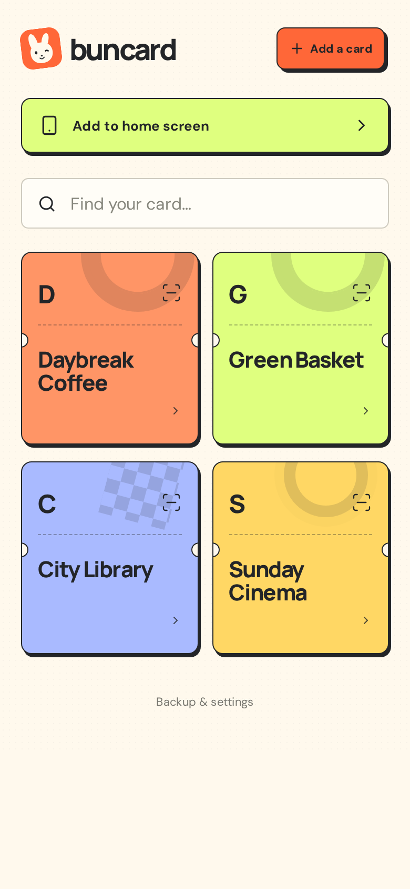
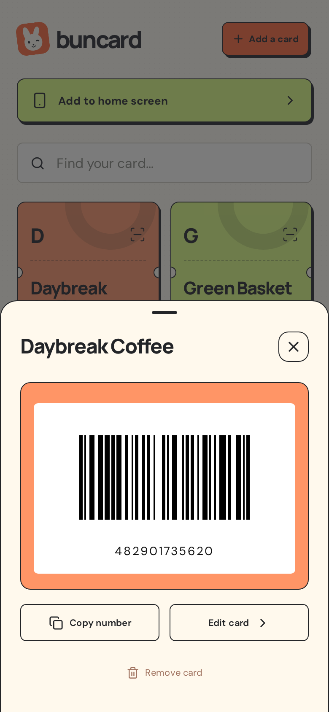

# Buncard

I built Buncard because I wanted a straightforward loyalty card app: open it, pick a card, and scan the barcode. No extra fluff, no accounts, and no cloud requirement.

Your cards stay locally on your device. Add Buncard to your home screen and use it offline. Import and export JSON backups whenever you need to save a copy or move to a new phone.

**[Open Buncard →](https://buncard.vercel.app)**

## Screenshots

<p>
  
  
</p>

Screenshots use fictional sample cards.

## Run locally

Requires Node 22.12+.

```sh
npm ci
npm run dev
```

`npm run build` creates the production build in `dist`.

Export a backup before clearing browser data or switching devices.
